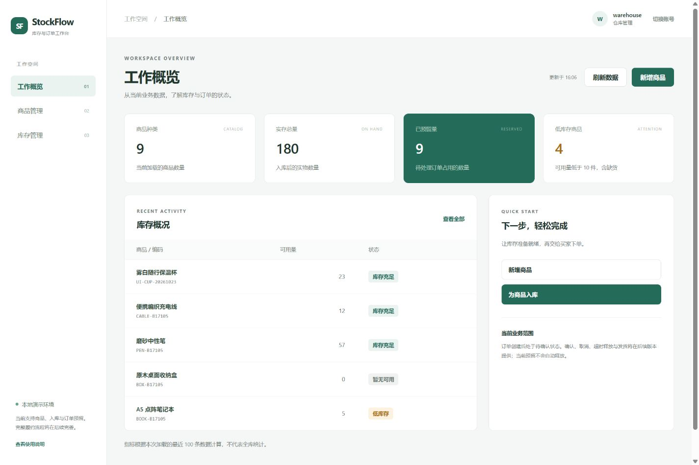

# StockFlow

单仓库存与订单履约系统。面向 Java 后端学习和项目实践，先通过真实数据库验证事务、并发库存和请求幂等，再逐步完善履约及异步可靠性。

当前阶段为 **P0：库存与订单创建**。代码是独立实现的业务项目，没有复制中州养老课程项目或复用它的数据库。

## 已实现范围

- 本地演示身份：buyer、buyer2、warehouse、admin；标准 Spring Security HTTP Basic。
- 商品创建与列表、库存查询、带操作键的幂等入库。
- 订单创建、列表、详情和买家资源归属校验。
- 合并重复 SKU、数量上限、服务端价格快照及请求内容指纹。
- MySQL 事务内预留库存、写订单明细与库存流水；多 SKU 失败整笔回滚。
- 同一买家同一请求键重放；内容改变返回冲突；失败事务结束后再读取原结果。
- 带角色导航的管理工作台：业务表格、搜索分页、图形化下单和订单详情；真实 HTTP/MySQL 集成测试。

确认、取消、超时回收、发货和完成属于 P1；Redis、RabbitMQ/outbox 属于 P2。目前没有实现这些后续能力，不能将它们列为已经完成的简历成果。

## 技术

Java 17、Spring Boot 4.1.0、Spring Security、Bean Validation、MyBatis 4.1.0、MySQL 8/InnoDB、Maven、JUnit。采用一个后端进程，按业务包组织。前端采用原生 ES Modules、HTML 和 CSS，随 JAR 提供，无需单独安装前端依赖。

库存满足 `on_hand >= reserved >= 0`，可用量计算为 `on_hand - reserved`。下单金额来自数据库商品价格，浏览器不能指定买家、总额或订单状态。

## Windows 本地启动

需要 **Java 17+、Maven 3.6.3+、MySQL Server 8 和 PowerShell 7**。下面的脚本使用已有 MySQL 程序启动一个独立实例，不安装或修改 Windows MySQL 服务。

在项目根目录运行：

```powershell
# 默认程序目录为 C:\Program Files\MySQL\MySQL Server 8.0；可通过 -MySqlHome 指定
.\tools\Start-LocalDatabase.ps1

# Maven 已在 PATH 或 MAVEN_HOME 中时无需 -Maven；也可显式传入 mvn.cmd
.\tools\Invoke-Local.ps1 -Action test
.\tools\Invoke-Local.ps1 -Action package
.\tools\Invoke-Local.ps1 -Action run
```

打开 [本地演示页面](http://127.0.0.1:8082)。口令保存在 **.local/demo-login.txt**，只保存在当前机器，不提交 Git。

先使用 warehouse 创建商品并入库，再通过“切换账号”以 buyer 下单。下单页直接选择商品和数量；提交后点击“重试本次下单”返回同一订单，点击“开始另一笔订单”生成新的请求标识。入库也提供原操作重试和新一笔操作。

开发实例仅监听 127.0.0.1:3308；应用仅监听 127.0.0.1:8082。stockflow_dev 和 stockflow_test 使用不同数据库用户和随机口令，不使用课程库 zzyl10。

停止应用使用所在终端的 Ctrl+C。停止独立数据库：

```powershell
.\tools\Invoke-Local.ps1 -Action stop-db
```

## 其他环境

通过环境变量配置数据库，使用专门为 StockFlow 建立的空数据库：

| 变量 | 用途 |
|---|---|
| STOCKFLOW_DB_URL / STOCKFLOW_DB_USERNAME / STOCKFLOW_DB_PASSWORD | 开发运行库 |
| STOCKFLOW_TEST_DB_URL / STOCKFLOW_TEST_DB_USERNAME / STOCKFLOW_TEST_DB_PASSWORD | 独立测试库 |
| STOCKFLOW_DEMO_PASSWORD | 至少 12 字符的本地演示口令 |

测试会清理 **stockflow_test** 的业务表，并在清理前检查实际数据库名；禁止把测试配置指向业务库。schema.sql 只负责此初始版本的建表，不会替已有表执行自动升级；后续结构变更需添加正式迁移。

四个演示用户仅用于 local/test 环境，账号 ID 固定，用于资源归属校验。HTTP Basic 不是公网部署方案；公开部署前需要正式用户管理、身份认证、HTTPS 和部署安全评审。

## API

| 请求 | 权限 | 说明 |
|---|---|---|
| GET /api/health | 无 | 进程存活状态，不是数据库健康检查 |
| GET /api/auth/me | 已登录 | 当前演示身份 |
| GET /api/skus | 已登录 | 最近 100 个商品 |
| POST /api/skus | warehouse/admin | 创建商品，返回 201 |
| GET /api/inventory | warehouse/admin | 最近 100 条库存 |
| POST /api/inventory/{skuId}/receipts | warehouse/admin | 幂等入库 |
| POST /api/orders | buyer/buyer2 | 新订单 201，原请求重放 200 |
| GET /api/orders | buyer/buyer2 | 最近 100 笔本人订单 |
| GET /api/orders/{id} | 所属买家 | 详情；他人订单返回 404 |

操作键和请求键最多 64 字符，使用字母、数字、点、下划线、冒号和连字符。每单最多 10 种 SKU，合并后的单 SKU 数量为 1–99。

错误包含 code、message、requestId；X-Request-Id 响应头可用于关联问题。不向客户端返回堆栈或 SQL。

可导入 [IntelliJ HTTP 示例](examples/stockflow.http)；不要将真实口令写入公开示例。

## 前端工作台



- 工作概览按角色显示本次加载数据的指标，不使用模拟趋势或全库统计。
- 商品与库存表格支持名称/编码搜索、库存状态筛选及本地分页；仓管可通过弹窗创建商品与入库。
- 买家直接选择商品与数量下单，金额按整数分预览，最终以服务端价格快照为准。
- 请求重试保留原标识；账号切换清空旧数据；旧详情响应不会覆盖新详情。
- 提供空数据、加载、错误和成功状态；移动端支持折叠菜单、表格区域内滚动和单列下单布局。

[图形化下单截图](docs/screenshots/create-order.png) · [移动端截图](docs/screenshots/mobile-order.png) · [UI 验收记录](design-qa.md)

前端不需要构建即可运行。开发行为测试需要 Node.js 24：

```powershell
node --test src/test/frontend/*.test.mjs
```

## 验证与交付

`mvn test` 运行规范化测试和独立 MySQL 集成测试。集成测试使用实际 HTTP、事务、唯一约束和库存条件更新，不以 H2 或 mock 替代数据库行为。

本地已验证：**23 项后端测试通过**（6 项规范化测试、17 项真实 HTTP/MySQL 集成测试），另有 **19 项前端测试通过**，失败、错误和跳过均为 0。并发场景包含 100 请求争抢 10 件库存，以及 50 个相同请求键并发重放。它们验证正确性，不是吞吐量基准。

评审补充了小数数量、小数 SKU ID 的三项回归测试：修复前均被错误接受，修复后返回 400 且不产生库存或流水变更。已启动最终打包的 JAR，验证页面资源、认证、正常下单、请求重放和买家隔离；已在内置浏览器完成桌面与 390 像素移动宽度的核心交互验收。GitHub Actions 尚未在线执行。

后端初始证据位于 `artifacts/p0-reviewed/`；本次前端升级证据位于 `artifacts/ui-20261023/`，包括最终打包、前端测试和截图。这些目录忽略提交。跟踪的 [执行与验证记录](docs/progress.md) 保留验证结论及剩余事项。

GitHub Actions 工作流配置了临时 MySQL 服务和构建测试，但只有上传仓库并实际执行后才能声称 CI 通过。CI 配置中的口令是一次性任务环境的示例，不是本机凭据。

- [设计稿](docs/specs/2026-10-22-stockflow-design.md)
- [P0 实施计划](docs/plans/2026-10-22-p0-implementation.md)
- [执行与验证记录](docs/progress.md)

目前列表有明确的 100 条上限，页面内按每页 8 条分页；全库游标分页、P1 履约操作、部署和基准报告留在后续迭代。
