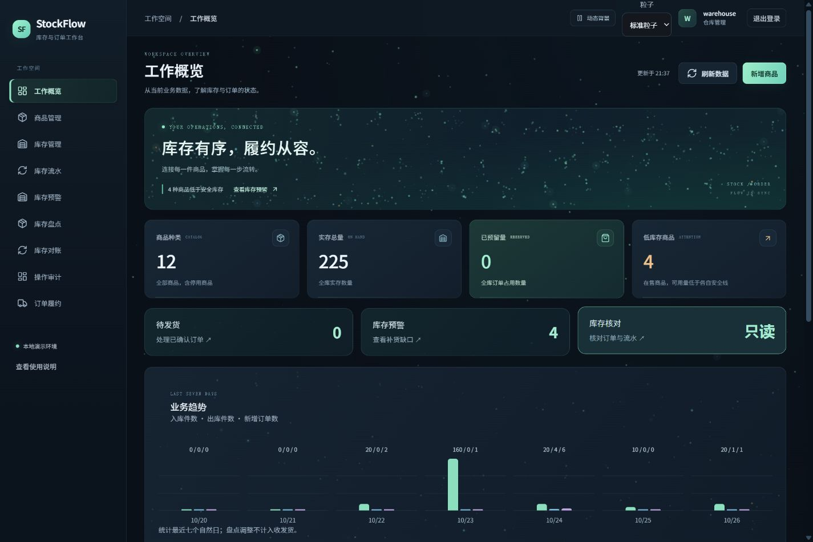

# StockFlow

单仓库存与订单履约系统，面向 Java 后端学习与实习项目展示。当前实现 **持久化账号、订单履约闭环、库存流水、低库存预警、盘点对账、操作审计、正式入库单与整单退货**，业务核心独立编写，未复制课程项目或使用课程数据库。

## 完整项目文档

[文档中心](docs/handbook/README.md)提供需求规格、系统设计、业务规则、完整资料字典、API、部署运维、测试验收、使用手册及项目展示指南。文档1.1以33c830f为功能基准，补充第一阶段前端整理，明确区分实现、验证与后续规划。

## 已实现

- MySQL 账号持久化、买家注册、BCrypt 密码哈希、登录、会话恢复和退出失效。
- Spring Security 服务端会话；浏览器使用 HttpOnly / SameSite=Lax Cookie，写入操作校验 CSRF。
- 买家、仓管、管理员角色与订单资源归属校验。公开注册固定为 BUYER。
- 商品创建、详情查询、名称/价格编辑和上架/停用；商品、库存、订单全量分页与搜索；带操作键的幂等入库。
- 订单明细保存下单时商品名称/编码/单价快照；商品后续改名不改历史，新旧明细明确区分，旧数据不补造历史名称。
- 正式入库单：多行商品、来源说明、草稿/确认/取消、幂等创建与确认，整张单据的库存/流水/审计同事务。
- 整单退货：仅本人已完成订单可申请，仓管核实收到且可再次销售后确认入库；取消申请、重复请求和并发确认不会重复入库，不涉及退款。
- 多商品下单、规范化数量、服务端价格快照、请求内容指纹及幂等重放。
- 下单预留、确认、取消释放、超时取消释放、仓管发货扣减、买家确认收货。
- 订单状态、库存和流水在同一 MySQL 事务内更新；多 SKU 失败整体回滚。
- 数据库全量汇总工作概览、商品/库存/本人订单/仓管履约分页列表、状态筛选和图形化下单。
- 商品详情抽屉串联商品资料、库存和该商品流水；订单/入库选择器支持搜索全部商品目录。
- 库存流水查询：入库、订单预留、取消释放与发货出库，展示实存/预留变化，支持商品搜索、类型筛选及游标分页。
- 商品安全库存持久化：每商品默认 10 件，可由仓管/管理员调整；概览与库存状态读取保存规则。预警仅在售商品，显示安全线、补货差额并支持直接入库。
- 订单履约时间线：创建、确认、发货、收货和取消时间由数据库记录；状态和时间同事务更新，重复操作保留首次时间。历史缺失时间明确标注。
- 幂等盘点单：保存库存版本快照，确认时检查变化和预留下限，盘盈/盘亏、库存及审计同事务更新；支持取消与重复确认安全重放。
- 只读库存对账：实存对累计流水，预留对累计流水与有效订单；显示差异，不自动修正。
- 商品创建/编辑、安全库存与盘点的操作审计，记录操作人、前后值、请求编号；不保存凭据。
- 日期范围筛选订单、流水、盘点、审计；订单可按金额范围筛选。页面地址保存查询条件和页码，支持刷新与返回恢复；订单、履约、库存按当前权限与筛选导出 CSV，最多10000条并防公式注入。
- 按角色显示业务待办和真实七日趋势；表格复制编号、重置筛选、每页 8/20/50 条、固定表头，更新失败保留旧数据。
- 墨蓝深色界面、薄荷绿光感、全界面粒子背景、分层流动与鼠标连线；支持标准/低密度/关闭、暂停/恢复、减少动态效果、离屏停止绘制，保留表格可读性和手机布局。

当前没有接入真实支付、退款、物流、找回密码、管理员用户维护、Redis、RabbitMQ 或 outbox。退货只记录实物退回与入库。确认订单是模拟业务操作，不产生支付行为。

## 技术与运行边界

Java 17、Spring Boot 4.1.0、Spring Security、MyBatis 4.1.0、MySQL 8/InnoDB、Maven、JUnit。前端使用原生 ES Modules、HTML/CSS，随 JAR 提供，无需安装前端依赖。

这是本地学习/演示配置，仅监听 127.0.0.1。标准 HTTP Basic 保留给显式设置 Authorization 的本地 API 客户端与集成测试；此类请求豁免 CSRF，浏览器界面不发送 Basic 凭据。公网部署、HTTPS、限流和生产身份安全评审不属于本次交付。

## Windows 启动与已有数据库升级

需要 Java 17+、Maven 3.6.3+、MySQL Server 8、PowerShell 7。可用 `./tools/Start-StockFlow.ps1` 一次完成独立数据库启动、增量升级、首次打包与运行；已有 JAR 时运行阶段不查找 Maven。修改代码后加 `-Rebuild`，Maven 不在 PATH 时加 `-Maven <mvn.cmd路径>`。

也可分步执行以下保留数据的升级：

```powershell
.\tools\Start-LocalDatabase.ps1
.\tools\Update-LocalDatabase.ps1
.\tools\Invoke-Local.ps1 -Action package
.\tools\Invoke-Local.ps1 -Action run
```

Maven 未在 PATH / MAVEN_HOME 时，为 Invoke-Local.ps1 传入 -Maven 指定 mvn.cmd。数据库脚本使用独立 MySQL 目录与凭据，不修改原 Windows MySQL 服务。

打开 [本地工作台](http://127.0.0.1:8082)。演示账号 buyer、buyer2、warehouse、admin 的初始口令见本机 .local/demo-login.txt；注册账号使用自己设置的密码。登录会话在 30 分钟无活动后过期，退出会使当前会话立即失效。

数据库升级已统一由 Flyway 在应用启动时处理，`spring.sql.init.mode=never`；不再每次重放全部 SQL。`Update-LocalDatabase.ps1` 保留兼容入口，只提示启动当前 JAR 执行迁移。首次空库执行 B004 基线、V005 商品快照、V006 业务单据；现有无历史表的数据库仅在结构匹配已知 V004 时登记版本4后升级，未知或损坏结构拒绝自动接管。迁移不会删除原业务数据，老订单名称/编码快照保持 NULL。

运行时唯一迁移脚本位于 `src/main/resources/db/migration`。根目录 `db/migrations` 保留历史审阅资料；旧 `schema.sql` 仅保留迁移说明，不再负责建表。禁止对升级后的数据库手工重放旧脚本。

开发数据库：127.0.0.1:3308 / stockflow_dev；测试数据库：同实例的 stockflow_test，使用不同数据库用户与密码。课程库 zzyl10 没有参与升级。

测试会清理 stockflow_test 的业务表，并在清理前检查实际数据库名。不要把测试环境指向业务库。口令、数据库目录、构建文件和本机证据目录均由 Git 忽略。

## 体验完整流程

1. 用 warehouse 登录，创建商品并入库。
2. 退出后，用已注册买家或 buyer 登录；选择商品下单。
3. 在“我的订单”确认订单；待确认时也可取消，取消会释放预留。
4. 用 warehouse 登录，在“订单履约”筛选待发货订单，确认发货。
5. 买家再次登录，在“我的订单”确认收货，订单变为已完成。

订单有 15 分钟确认期限。超时任务每 30 秒检查一批、每批最多处理 100 单；到期订单自动取消并释放预留。失败订单会在后续扫描重试，跨批次游标保证它们不会永久阻挡后续正常订单。

| 状态操作 | 结果 | 库存变化 |
|---|---|---|
| 创建订单 | 待确认 | reserved 增加 |
| 买家确认 | 已确认 | 无 |
| 买家取消 / 待确认超时 | 已取消 | reserved 减少 |
| 仓管发货 | 已发货 | on_hand 与 reserved 同时减少 |
| 买家确认收货 | 已完成 | 无 |

库存始终满足 on_hand >= reserved >= 0。确认后的订单不开放取消；已完成订单可走独立整单退货流程，原订单状态保持已完成；真实支付、退款与换货不在范围内。同一成功操作重试返回当前结果，不重复改动库存。

## API

| 请求 | 用途 |
|---|---|
| GET /api/health | 进程存活，不代表数据库就绪 |
| GET /api/health/readiness | 匿名可读的数据库就绪结果，失败503，不公开连接细节 |
| GET /api/runtime/metrics | 仓管/管理员可读的请求次数、耗时、状态分类及超时任务计数 |
| GET /api/orders/export、/api/fulfillment/orders/export、/api/inventory/export | 按权限与当前筛选导出CSV，超过10000条返回422 |
| GET / POST /api/receipts | 仓管/管理员分页查询与幂等建立入库单 |
| GET /api/receipts/{id}；POST /{id}/confirm 或 /cancel | 入库单详情、确认或取消 |
| GET / POST /api/returns | 买家本人／仓管全量查询；买家申请本人已完成订单整单退货 |
| GET /api/returns/{id}；POST /{id}/confirm 或 /cancel | 退货详情、仓管确认验收入库或本人取消申请 |
| GET /api/auth/csrf | 取得 CSRF token/headerName |
| POST /api/auth/register | JSON 买家注册，201，不自动登录 |
| POST /api/auth/login | 表单编码登录，200，创建/轮换会话 |
| GET /api/auth/me | 当前身份，匿名 401 |
| POST /api/auth/logout | 带 CSRF 退出，204 |
| GET / POST /api/skus | 兼容旧查询 / 仓管创建商品 |
| GET /api/skus/page | 全量商品搜索、销售状态、分页 |
| GET / PUT /api/skus/{id} | 商品详情 / 仓管修改名称、价格、销售状态 |
| GET /api/dashboard | 当前角色范围内的数据库全量汇总 |
| GET /api/dashboard/trends | 最近七个自然日真实业务趋势，买家仅本人订单 |
| GET /api/audit | 仓管/管理员的操作审计、关键词和类型筛选 |
| GET /api/inventory/reconciliation | 仓管/管理员只读库存核对，支持仅显示差异 |
| GET / POST /api/stocktakes | 盘点分页查询 / 幂等创建草稿 |
| GET /api/stocktakes/{id} | 盘点快照、数量、原因与状态 |
| POST /api/stocktakes/{id}/confirm | 校验版本与预留量，确认并调整库存 |
| POST /api/stocktakes/{id}/cancel | 取消草稿，不修改库存 |
| GET /api/inventory/page | 仓管全量库存搜索、状态与分页 |
| GET /api/inventory/{skuId} | 仓管单商品库存及安全库存 |
| PUT /api/inventory/{skuId}/policy | 仓管保存商品安全库存，JSON {safetyStock}，1–1000000 |
| GET /api/orders/page | 本人订单全量查询与分页 |
| GET /api/fulfillment/orders/page | 仓管订单全量查询与分页 |
| GET /api/inventory | 仓管查询库存 |
| POST /api/inventory/{skuId}/receipts | 仓管幂等入库 |
| GET /api/inventory/ledger | 仓管流水查询，q/type/skuId/beforeId/limit |
| GET /api/inventory/alerts | 仓管全量预警，默认按商品规则；q/beforeId/limit，可选 threshold 临时覆盖 |
| GET / POST /api/orders | 本人订单列表 / 幂等创建 |
| GET /api/orders/{id} | 本人订单详情 |
| POST /api/orders/{id}/confirm | 本人确认 |
| POST /api/orders/{id}/cancel | 本人取消 |
| POST /api/orders/{id}/complete | 本人确认收货 |
| GET /api/fulfillment/orders | 仓管/管理员订单列表 |
| GET /api/fulfillment/orders/{id} | 仓管/管理员订单详情 |
| POST /api/fulfillment/orders/{id}/ship | 仓管/管理员发货 |

浏览器会话下所有写入请求均带 X-CSRF-TOKEN。用户、角色、价格、总额、库存余额和订单状态由服务端确定，前端不能直接指定。买家访问他人订单返回 404；缺少角色返回 403；状态/库存冲突返回 409；字段非法返回 400。错误带 requestId，不返回堆栈或 SQL。

注册账号为 3–32 位小写字母/数字/下划线，以字母开头。密码为 8–64 个字符，BCrypt 输入最多 72 个 UTF-8 字节；仅保存哈希。
每单最多 10 种 SKU，同一 SKU 合并后数量为 1–99。金额由数据库商品价格快照计算。

[IntelliJ HTTP 示例](examples/stockflow.http) 使用本地 Basic 凭据变量，不在文件内保存真实口令。

## 界面与验证



[盘点确认](docs/screenshots/operations-count-confirmed.png) · [只读对账](docs/screenshots/operations-reconciliation.png) · [手机审计](docs/screenshots/operations-mobile-audit.png)

[全量商品列表](docs/screenshots/complete-products.png) · [商品详情](docs/screenshots/complete-product-detail.png) · [商品编辑](docs/screenshots/complete-product-edit.png) · [手机详情](docs/screenshots/complete-mobile-product.png)

[库存流水](docs/screenshots/final-ledger.png) · [库存预警](docs/screenshots/final-alerts.png) · [手机预警页](docs/screenshots/final-mobile-alerts.png)

[登录](docs/screenshots/login.png) · [注册](docs/screenshots/register.png) · [订单履约](docs/screenshots/fulfillment.png) · [本人订单](docs/screenshots/orders.png) · [下单](docs/screenshots/create-order.png) · [移动端](docs/screenshots/mobile-order.png)

鼠标停留时，按钮轻微抬升、指标卡增加阴影、导航轻微平移、输入框边框渐变。动画仅对精细鼠标且未要求减少动态效果的设备启用。

浏览器中的商品、库存和订单列表均搜索全库，每页默认 8 条，返回完整筛选总数。首页指标直接由服务端汇总；下方近期记录独立查询，不受列表筛选影响。买家订单和汇总限定本人，订单金额包含已取消订单，不是营收。流水和预警每页 20 条，使用编号游标翻页；旧数组列表接口为兼容已有调用保留。预警总数覆盖完整筛选集合；预警默认按各商品保存的安全库存判断，默认 10 件，严格低于才预警。每行返回 safetyStock、有效 threshold 和 shortage；顶层 threshold 在默认模式为 null。保留可选 threshold 参数供旧客户端临时覆盖查询，不修改保存规则。停用商品不进入预警；库存列表仍能查看停用库存。没有邮件或推送通知。状态操作以服务端响应为准。

```powershell
node --test src/test/frontend/*.test.mjs
.\tools\Invoke-Local.ps1 -Action test
```

2026-10-27 的验证记录：**96项常规 Java/MySQL 测试通过；1项大数据测量单独通过；89项前端测试通过，项目打包成功**。旧版本曾完成账号、订单、到期释放和悬停动画的真实浏览器验证；最新入库、退货及范围筛选流程的 Edge 桌面／手机实操仍待补验。详细记录见 [执行记录](docs/progress.md) 与 [UI 验收](design-qa.md)。真实 MySQL 测试覆盖事务、并发库存、请求幂等、注册唯一性、会话/CSRF、状态竞争、重复操作、超时释放及失败回滚。测试通过只代表相应范围，不是生产认证。本轮附带有条件的本地并发测量，见 [盘点与交付验收](docs/operations-hardening-qa.md)。
本机运行目录与凭据均忽略提交。GitHub Actions 已实际执行前端/Java/MySQL测试及 Docker Compose 构建、启动和接口检查；查看 [PR 检查](https://github.com/1028706210/StockFlow/pull/1/checks) 与 [首轮通过记录](https://github.com/1028706210/StockFlow/actions/runs/40332898399)。

[Figma/Canva 设计来源](docs/UI-DESIGN.md) · [初始业务设计](docs/specs/2026-10-22-stockflow-design.md) · [本轮设计](docs/specs/2026-10-23-account-fulfillment-design.md) · [本轮实施计划](docs/plans/2026-10-23-account-fulfillment.md)


2026-10-25 新增功能与界面验收详见 [库存可视化验收](docs/inventory-visibility-qa.md)。新接口复用现有库存事务记录，无数据库迁移。


2026-10-26 完成全量工作台、商品维护和商品详情，详见 [完整工作台验收](docs/complete-workbench-qa.md)。改价保留历史订单价格快照；停用不影响已有订单继续履约。此轮没有数据库迁移。

2026-10-26 完成商品安全库存与订单时间线，详见 [本轮验收](docs/stock-policy-timeline-qa.md)。

[商品安全库存预警](docs/screenshots/business-alerts.png) · [完整履约时间线](docs/screenshots/business-timeline.png) · [手机时间线](docs/screenshots/business-mobile-timeline.png) · [手机规则设置](docs/screenshots/business-mobile-policy.png)

2026-10-26 完成 Figma/Canva 粒子视觉升级，详见 [界面验收](docs/particle-ui-qa.md)。[登录效果](docs/screenshots/particle-login.png) · [手机概览](docs/screenshots/particle-mobile-overview.png) · [手机登录](docs/screenshots/particle-mobile-login.png)。

2026-10-26 将粒子扩展到所有业务页面、表格内容区与弹窗，统一全域漂浮光点、多层流动、页面色调和鼠标连接。详见 [全界面粒子验收](docs/all-pages-particles-qa.md)。

## 容器运行与盘点

Docker Desktop 使用 Linux 容器时，运行 `./tools/Start-Container.ps1`；首次会生成忽略提交的 `.local/compose.env`，保存随机数据库/演示口令与端口，默认地址为 http://127.0.0.1:8083。MySQL 不映射宿主机端口。关闭用 `docker compose --env-file .local/compose.env down`，不删除数据卷。Compose 的首次建库和启动已在 GitHub Linux runner 验证，本机无 Docker Desktop，未声称做过本机容器验收。已有旧版容器数据卷由启动时的 Flyway 校验并升级；无法识别的旧结构会停止启动，保留数据供人工核对，不会自动删除或重建旧卷。

仓管在“库存盘点”或商品详情建立盘点，填写实际数量和原因，再确认调整。草稿建立后任何收发、预留或释放均使原快照失效，即使数量恢复原值也需要重新盘点；安全库存规则调整不改变实盘快照版本。确认后有差额才写入 ADJUST_IN / ADJUST_OUT 流水，零差额仍保留确认审计。盘点不能用来绕过订单预留或修复丢失的历史流水；对账只揭示差异。


## 业务咨询助手

登录工作台后，点击右下角“咨询助手”。可询问业务规则、查询在售商品与买家本人订单；直接使用当前登录会话，不用重复输入密码。退出或切换账号会清空对话并丢弃旧请求结果。支持快捷问题、失败重试、Enter发送、Shift+Enter换行、Escape关闭和手机布局。

聊天为规则与只读数据咨询，不代替确认/取消/发货操作。工作台内聊天无需启动 Node 进程；独立页面在 [Node聊天页](http://127.0.0.1:8787)，需要另启动 ../Node.js 项目。共享源码在 ../Node.js/web，规则在 ../Node.js/config/knowledge.json，通过其 tools/Install-StockFlowChat.ps1 同步后重新打包。

咨询助手独立接入阶段的记录为74项前端测试与真实Edge验收通过，当时未运行Java/MySQL测试；当前完整功能基线与测试口径见文档中心。详见 [聊天验收](docs/chat-assistant-qa.md)。

## 2026-10-27 完整业务与可靠性改进

订单历史快照、日期/金额筛选、查询地址恢复、CSV导出、入库单、整单退货、Flyway保留数据升级、真实就绪检查和受限运行指标均已接入。入口为“入库单”“退货单”；买家在已完成订单详情中发起退货，仓管在退货详情勾选已核实实物后确认。单据确认与流水可相互追踪。

`/api/runtime/metrics` 只返回固定数量的累积计数，不保存请求正文、密码或任意用户标签。请求耗时为累计纳秒，可除以请求次数计算平均值；超时任务包含批次、处理成功、订单失败和查询批次失败。

大数据测量仅在设置 `STOCKFLOW_LARGE_DATA_EVIDENCE=true` 时执行，会清理命名为 `stockflow_test` 的测试业务表；迁移破坏性夹具只允许 `stockflow_test_migration`。CI会运行两者并保存报告。配置与完整条件见 [本轮验收](docs/business-reliability-qa.md) 和 [测量样本](docs/evidence/2026-10-27-large-data.json)。

2026-10-27至28日尝试验收时，工具返回本机Work设置关闭浏览器控制，最新单据的桌面／手机真实页面验收尚未完成。已有HTTP/MySQL、前端状态及问答回归、静态模块加载与JAR运行验证；此前截图仅代表对应历史版本。

## 可维护性分阶段改进

2026-10-29 第一阶段已拆出通用界面工具和库存流水／预警模块，保持原生 JavaScript、界面和业务接口。89项前端回归通过，JAR打包及匿名静态模块HTTP加载检查通过；本地没有重跑后端全套或完成新页面实操。见 [阶段计划](docs/plans/2026-10-29-maintainability-phases.md) 与 [第一阶段记录](docs/maintainability-stage1-qa.md)。以后新增文档、界面文案及说明统一使用简体中文。

2026-10-29 第二阶段已将入库单、退货单列表的明细改为当前页批量查询，100条页面的单据SELECT由实测102次降至3次，完整响应和权限保持一致。已补5项真实MySQL查询回归；全量后端101项通过、前端89项通过、Maven verify成功。本地未开启的1项大量数据测试由云端另行执行。参见[第二阶段记录](docs/maintainability-stage2-qa.md)和[验证数据](docs/evidence/maintainability-stage2.json)。文档总册1.1保留原内容基线，本阶段变更以增量记录为准。
