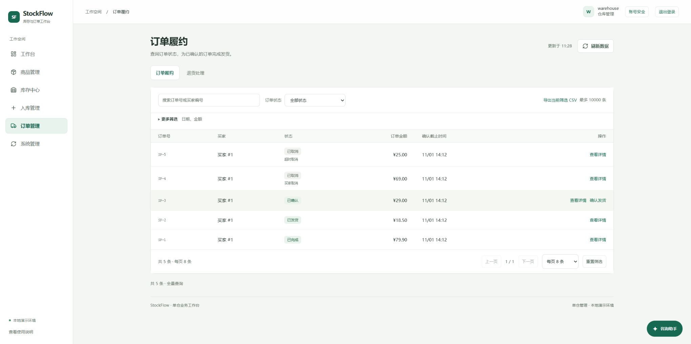
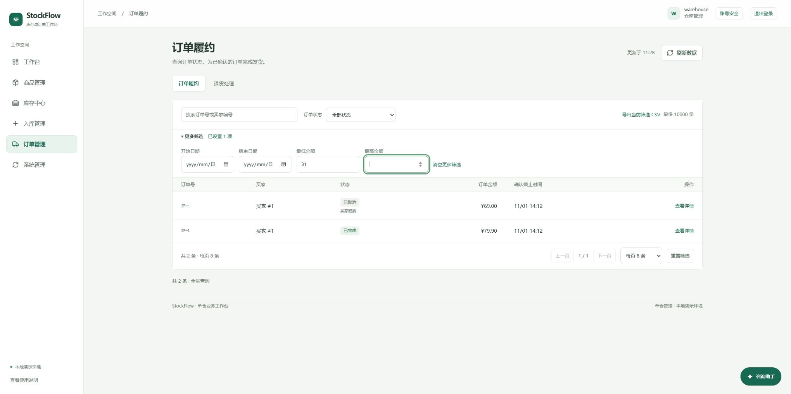

# 业务查询区减负说明

2026-11-03，在浅色与6组导航基础上，精简原有业务查询区。未增加业务页、查询参数、数据库迁移或第三方依赖。

## 页面变化

| 页面 | 常驻条件 | 更多筛选 |
|---|---|---|
| 订单履约 | 订单号/买家编号、状态、导出 | 起止日期、最低/最高金额 |
| 我的订单 | 本人订单号、状态、导出 | 起止日期、最低/最高金额 |
| 库存流水 | 商品名称/编码、业务类型、查询 | 起止日期 |
| 操作审计 | 关键词、操作类型、查询 | 起止日期 |

库存列表的原导出入口也移入常用工具条。原控件ID、权限、查询与导出逻辑保留。使用原生details/summary，支持键盘进入和展开，不维护另一套自定义浮层。

有范围参数的地址在刷新、后退时自动展开；手动收起后再刷新数据不会抢回展开状态。摘要写“已设置N项”，包含金额0，既不把未提交条件当作已应用，也不把失败请求当作成功。流水/审计编辑日期但未查询时，只同步摘要，不请求接口或修改地址。

“清空更多筛选”仅清日期和金额，保留关键词、状态或业务类型，复用原查询重置页码/流水游标，关闭后焦点回到summary。退出清空范围控件和展开状态；跨账号登录仍按既有规则去除上一身份的查询地址。

原生无效输入会展开所属区域，浏览器可以聚焦错误字段。本轮确实复现了日期输入不完整后收起、原生提交校验拦截却无法聚焦的问题；修复没有绕过或关闭校验。

## 实际验收步骤

1. 订单履约默认收起4个范围字段，真实列表5条；原生键盘设置最低金额31后为2条，收起摘要仍显示1项。刷新页面展开恢复，手动收起后“刷新数据”保持收起；最低金额1000显示0条及调整条件提示，清空后回到5条并恢复摘要焦点。
2. 库存流水用真实表单复现部分日期badInput，修复前收起提交后区域仍关闭、焦点空；修复后自动展开且焦点在ledger-from，原生badInput仍为true。日期编辑的摘要即时同步。
3. 操作审计设置开始日期后摘要为1项，点击查询返回真实记录。320像素展开状态无页面横向溢出，摘要高约44.8像素。
4. 买家/shop订单页在同一身份下恢复COMPLETED与minTotal=0，显示本人已完成订单SF-1。320像素无页面横向溢出且没有无效仓管菜单。点击导出后，实际CSV为1条，订单SF-1、COMPLETED、79.90，与页面一致；浏览器工具下载事件超时，随后核对了本次11:25:26生成的实际文件，不把事件通知当作下载成功依据。

手机截图见[仓管订单](evidence/2026-11-03-compact-warehouse-mobile.jpg)和[买家订单](evidence/2026-11-03-compact-mobile.jpg)。订单桌面及仓管手机来自最终8096部署，买家手机来自相同源码的8097预览，API始终为真实Java服务。

## 验证与维护

8项新增行为回归均先失败再修复。全套Node157项通过，其中StockFlow129、独立商城28。Java/MySQL共123项检查，122通过、1项大数据证据专项未启用；失败/错误均为0。最终前端修复后再次打包成功，运行JAR与构建JAR哈希一致，就绪UP。详细数据见[验收JSON](evidence/2026-11-03-compact-filters.json)。

独立代码审查发现1项日期编辑摘要问题，已补回归修复；聚焦复核未发现重要回归。浏览器另发现并修复隐藏无效日期无法聚焦。浏览器扩展自身有报错，未将其算为本项目异常，也不声称整个浏览器控制台无错误。

只在app.js复用readQuery、persistQuery、restoreQuery和原加载函数；主题规则在atmosphere.css。不改服务端权限、CSRF、事务或归属。实际使用Product Design审查工作流、Edge、代码与GitHub工具，没有新建Figma/Canva文件。

这是本地展示及源码交付，不代表生产上线、实体手机、多浏览器、全面安全或无障碍认证。本轮没有在浏览器创建订单、确认发货或改变库存。历史PDF与旧截图保留日期；最终提交与本轮CI须按仓库和交付记录核对。
