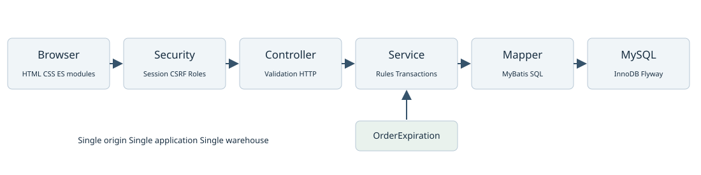

# StockFlow 系统设计

## 架构与边界

系统采用单体、同源部署：Spring Boot 同时提供静态前端和REST接口，一个 MySQL 数据库保存业务状态。这符合单仓演示规模，避免为学习展示额外引入跨服务事务与部署成本。

前端 ES modules → Spring Security及请求编号过滤器 → Controller参数验证 → Service权限归属与事务 → MyBatis Mapper → MySQL InnoDB。订单到期任务直接调用同一OrderService，所有业务写入仍经过后端规则。

## 模组职责

| 包或资源 | 职责与代表类型 |
|---|---|
| auth | 账号注册、BCrypt、身份、会话、CSRF、演示账号；AccountService、SecurityConfiguration |
| catalog | SKU读写、商品启停、零库存初始化、商品审计；CatalogService |
| inventory | 实存／预留条件更新、直接收货、流水、预警、安全线；InventoryService、InventoryMapper |
| order | 下单规范化、幂等、确认取消、收货、发货和到期释放；OrderService |
| fulfillment | 仓管订单入口及定时到期扫描；FulfillmentController、OrderExpiration |
| documents | 多行入库与整单退货的建立、查询、确认和取消；DocumentService |
| operations | 盘点草稿、版本检查、审计、对账和趋势；StocktakeService、AuditService |
| workbench | 全量分页、范围共用、工作台汇总、受限CSV；WorkbenchService、QueryRange |
| runtime与api | Flyway旧库校验、就绪、固定指标、统一错误、requestId |
| static | app.js主流程，ui-helpers通用界面工具，inventory-reports库存报表，query-state、document-state、business-documents及咨询助手 |

## 事务与并发

新增订单在同一事务建立主表、预留库存、保存价格与商品快照、写明细及RESERVE流水、计算总额。任一SKU失败整单回滚。预留SQL直接判断 `on_hand-reserved >= quantity`，不采用前端读取数量再无条件覆盖。

确认、取消与发货先锁订单行，再按SKU升序处理库存；多商品规范化使用TreeMap固定顺序，降低交错锁顺序风险。建立订单遇悲观锁竞争最多尝试3次，仍失败回503 RETRY_LATER，客户端保留原requestKey重试。此重试策略只存在于相应下单路径，不能描述为所有接口都有自动重试。

入库／退货确认锁单据，依SKU顺序锁库存，更新实存与版本、流水、单据状态、审计同事务。退货申请另锁原订单，检查有效／成功退货数量，确保不同请求键也不能重复建立有效退货。这个限制由服务事务及锁保证，数据库没有单独的「每订单唯一有效退货」索引。

盘点先锁草稿及库存行，比较保存版本。库存实物或预留变动增加version，即使数量往返恢复也视为新版本；修改安全线不改version。需要一致的列表总数与行数据时，相关查询使用只读REPEATABLE_READ事务；连接池默认READ_COMMITTED。

## 前端状态与失败处理

2026-10-29第一阶段已把通用DOM与格式化工具移到 `assets/ui/ui-helpers.mjs`，把库存流水／预警的加载、渲染和游标交互移到 `assets/ui/inventory-reports.mjs`。主程序保留初始化及跨页面导航，未更换框架或修改API。

前端以 `#orders?...` 等Hash保存页面、筛选和页码；列表统计来源是后端完整集合，不是在目前页面做局部过滤。库存流水和预警使用编号游标，其余主列表使用page／size；前端常用容量8、20、50，后端上限100。

身份epoch用于丢弃退出、换账号后的旧请求结果；document-state保存一次提交的数据与请求键，避免未知网路结果时建立另一张单。载入错误时保留已有列表并限制旧操作，提供重试；成功与否以后端响应及重新查询为准。

弹窗支援关闭后焦点恢复，确认退货前有实物核实勾选。该勾选是前端提醒，后端没有独立验收证据字段、附件或双人复核流程。不能把它说成完整的仓库验收留痕。

## 鉴权与数据安全设计

浏览器使用JSESSIONID会话，闲置超时30分钟，Cookie为HttpOnly、SameSite=Lax。写入先取CSRF，使用回传headerName及token。Basic用于本机脚本与HTTP示例；带Basic前缀的请求在目前实现中豁免CSRF，生产暴露前需要重新评估此相容策略。

方法角色限制在服务端执行，买家编号来自当前Authentication，请求不能指定role、buyerId、价格或总额。错误响应仅包含code、message、requestId，详细例外保存在服务日志；审计储存业务前后值，不储存登入口令。

## 运行与设计决策

保留同源会话而未采JWT，因目前没有跨域多端需求；保留MySQL条件更新与行锁而未引入Redis分散式锁，因一致性边界都在同一数据库；使用有限固定指标而未搭完整监控平台，因当前是可演示原型。

就绪接口检查数据库连接、V006成功记录及订单快照字段可解析性，不是完整业务表校验。指标为进程内累加，重启清零；expiry.succeeded表示expire呼叫未抛例外，可能包含竞争后无需修改的情况，不等同成功取消订单的精确数量。

## 时间与货币

金额使用BigDecimal与DECIMAL，不使用浮点计算；日期筛选按created_at，结束日转次日零点的排他上界。数据库时间字段使用DATETIME(6)，API使用LocalDateTime，未带时区；JDBC设定connectionTimeZone=UTC，但SQL CURRENT_TIMESTAMP与自然日仍受数据库session时区影响。因此目前没有统一的多时区业务契约，跨环境部署前要固定并验证时区，不能单凭JDBC参数宣称全部时间已转UTC。
