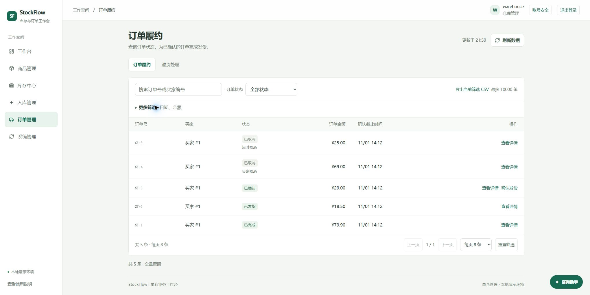

# 文字可读性与排版验收

2026-11-03，在现有浅色主题与六组导航基础上，统一放大文字、调整行距和控件尺寸。仅修改现有四个 CSS 文件，不增加依赖、业务接口、数据库迁移或设置页面。

## 当前规范

| 内容 | 字号与布局 |
|---|---|
| 正文、表单、咨询正文 | 16px；正文行高1.65，咨询输入行高1.7 |
| 表格正文、主按钮、桌面页内导航 | 15px；主按钮和输入框至少44px高 |
| 表头、辅助说明、文字操作 | 14px；状态、编号和趋势数值至少13px |
| 侧栏导航 | 16px；保留六组业务入口 |
| 页标题 | 桌面30px，手机28px |

手机日期与金额范围字段展开后使用单列，避免放大后日期被裁切。七日趋势保留13px数值，在自身容器横滑。买家订单、退货和详情表格保持可读列宽，在表格容器横滑；金额不拆行。1050px以下订购区改为单列，避免摘要挤压商品明细。手机买家导航为两列，清除重复面包屑和概览指标图标隐藏后的空白。

## 实际检查

- Edge最终本机服务8096：仓管桌面订单正文16px、表格15px、搜索16px；真实5条订单可见。桌面详情650px无对话框溢出，Escape关闭。
- 320px概览：页面宽度与滚动宽度均305px；指标标签右边距0；趋势内部243px、滚动660px，数值13px。展开履约筛选后日期输入约242px、16px，完整日期可读。
- 买家390px订购：数量99的保温杯预览为¥7,910.10，数量输入16px/44px，小计改为深色；页面宽度与滚动宽度均375px。未提交订单，检查后清空草稿。
- 买家390px订单：本人订单表格在342px容器内横滑600px；SF-5详情表格在302px容器内横滑560px，对话框宽度与滚动宽度均342px；未确认收货或修改订单。
- 买家320px商品目录：两列导航均15px，无页面横向溢出。800px订购单列布局已通过同源码8097预览检查，API使用真实8096后端。
- 咨询助手正文16px/1.65、输入16px/1.7；只打开检查，没有发送消息。手机登录输入16px，无页面横向溢出。

手机真实截图：[概览](evidence/2026-11-03-readable-overview.jpg)、[订购明细](evidence/2026-11-03-readable-cart.jpg)、[商品导航](evidence/2026-11-03-readable-catalog.jpg)。这些截图来自最终8096服务，不采用截图工具在日期原生控件聚焦时返回的缩小异常图。

## 验证、维护与边界

现有Node回归157项全部通过（StockFlow129、独立商城28），差异检查通过。独立只读CSS复核未发现新的阻断项。本轮未改Java业务代码，本地资源打包跳过Java测试；完整Java/MySQL与容器检查以本次提交GitHub Actions最终结果为准，不能引用旧提交的绿灯。

构建成功，D盘旧程序已备份，新运行JAR与构建JAR SHA256一致，就绪状态UP。具体哈希和测量见[验收数据](evidence/2026-11-03-readable-typography.json)。更新D盘前逐项确认四个CSS仍等于基准版本，未覆盖用户独立修改。

本轮使用Product Design审查工作流、Edge浏览器、代码和GitHub工具；没有新建Figma或Canva文件。响应式视口不等于实体手机验收，也不代表完成全面无障碍、跨浏览器或生产上线验证。历史截图和PDF保留其原日期。
